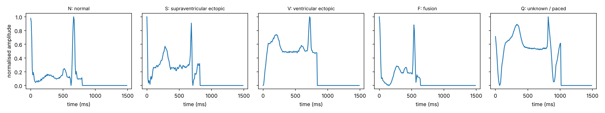
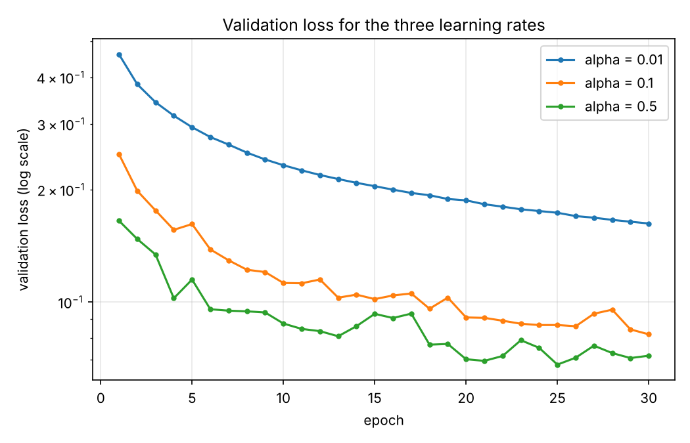
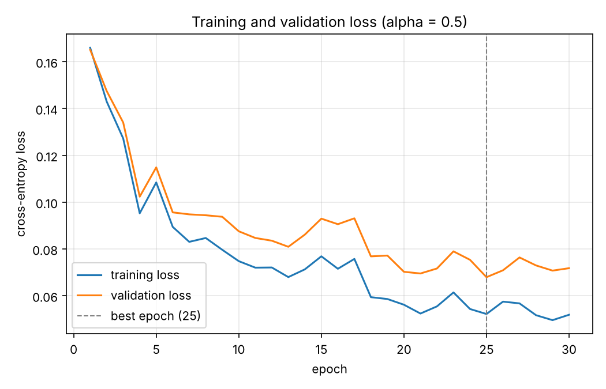
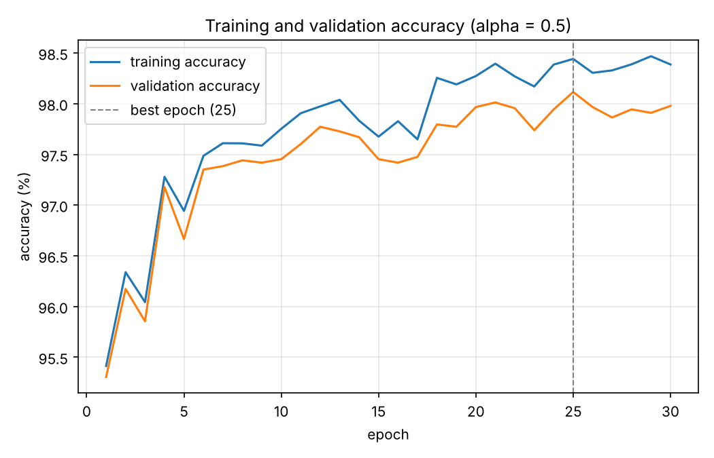
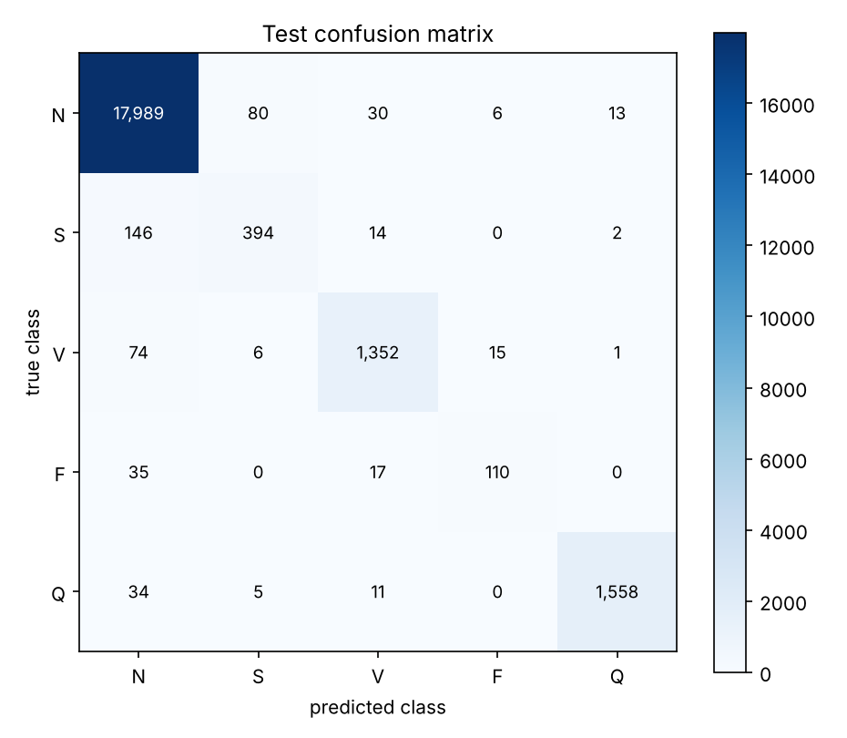
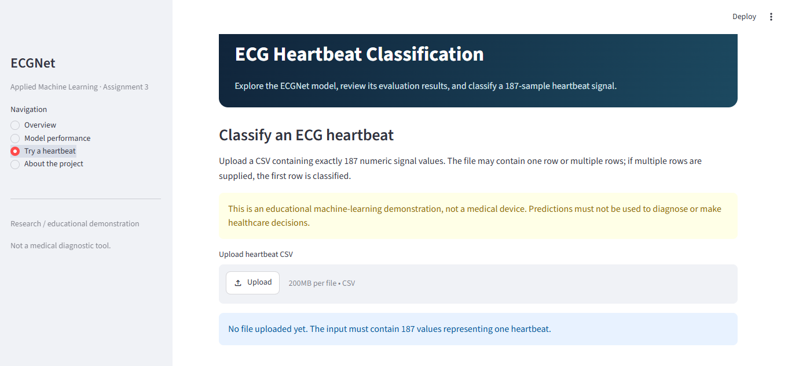

# Classifying Heartbeats from ECG Signals Using a Neural Network Built from Scratch in PyTorch

> **Project status:** The repository includes the ECGNet training/evaluation code, saved trained model, results, and a Streamlit frontend (`app.py`). The Medium blog draft and LinkedIn post draft are in `results/`; publication links should be added after publishing.

## 1. Project Overview

An electrocardiogram (ECG) records the heart's electrical activity. Every heartbeat has a characteristic waveform and abnormal beats (arrhythmias) have different shapes. This project builds a **fully connected neural network from scratch in PyTorch** that looks at **one heartbeat** (187 samples at 125 Hz) and decides its type:

| Label | Class |
|---:|---|
| 0 | N - normal beat |
| 1 | S - supraventricular ectopic beat |
| 2 | V - ventricular ectopic beat |
| 3 | F - fusion beat |
| 4 | Q - unknown or paced beat |

The weight matrices, the forward pass, the softmax cross-entropy loss and the mini-batch gradient descent update (momentum + weight decay) are all written by hand. PyTorch is used only for tensors and automatic differentiation (`loss.backward()`), and one gradient is additionally verified by hand.

**Key question:** how well does a small network recognise *each* type of heartbeat, and is overall accuracy the right number to trust when one class is far more common than the others?

## 2. Project Objectives

- Turn a raw CSV file of signals into tensors and split it correctly.
- Build a network from weight matrices (layers, ReLU, softmax) with He initialisation.
- Implement softmax cross-entropy and check a backpropagation gradient by hand.
- Train with mini-batch gradient descent, momentum and L2 weight decay (no `torch.optim`).
- Choose the learning rate with a validation set and keep the weights of the best epoch.

## 3. Dataset Description

**ECG Heartbeat Categorization Dataset** (Kaggle, `shayanfazeli/heartbeat`): single heartbeats cut from the MIT-BIH Arrhythmia Database, resampled to 125 Hz and zero-padded to 187 samples.

Files used: `mitbih_train.csv` and `mitbih_test.csv` (no header row; columns 0-186 = signal, column 187 = class label). `ptbdb_*.csv` are **not** used.

| Class | Train rows | Test rows |
|---|---:|---:|
| 0 - N | 72,471 | 18,118 |
| 1 - S | 2,223 | 556 |
| 2 - V | 5,788 | 1,448 |
| 3 - F | 641 | 162 |
| 4 - Q | 6,431 | 1,608 |
| **Total** | **87,554** | **21,892** |

### Getting the data

The CSV files are too large for GitHub and are listed in `.gitignore`. Download them and place them in `data/`:

```bash
# Option A: manually from https://www.kaggle.com/datasets/shayanfazeli/heartbeat  (Download -> unzip)
# Option B: Kaggle API (needs your kaggle.json)
kaggle datasets download -d shayanfazeli/heartbeat -p data --unzip
```

After this, `data/` must contain `mitbih_train.csv` and `mitbih_test.csv`.

## 4. Task 1 - Load and Prepare the Data (`src/prepare.py`)

1. Both files are loaded with the given loader (`src/load_data.py`) and their shapes printed (train `87554 x 188`, test `21892 x 188`).
2. Signal = columns 0-186, label = column 187. The label column is stored as `float64` in the CSV, so it is checked to contain only whole numbers and converted to `int64` (0-4).
3. The minimum and maximum signal value of the training file are reported (signals are already scaled and used as they are - **no extra normalisation**).
4. Rows per class are counted in both files and **checked automatically** against the table above (the script stops with an error if they differ).
5. `src/plot_beats.py` plots one beat per class -> `results/example_beats.png`.
6. The training file is split with exactly the code given in the assignment:

```python
rng = np.random.default_rng(42)
idx = rng.permutation(len(train_df))
n_val = int(0.1 * len(train_df))
val_idx, train_idx = idx[:n_val], idx[n_val:]
```

| Split | Rows |
|---|---:|
| Train | 78,799 |
| Validation | 8,755 |
| Test | 21,892 |

7. Signals are converted to `torch.float32` tensors and labels to `torch.long` tensors.

### How the five beat types look



The normal (N) beat has a low flat baseline with a small bump and one sharp, narrow peak (at about 680 ms in the plotted example). The S beat has the same kind of sharp peak but a larger bump before it and an extra small bump after it. The V beat is much wider: a broad hump rises from the start of the window and the sharp peak sits on a raised plateau (about 0.5). The F beat is a shorter beat whose peak comes earlier (about 540 ms) with a small double bump before it, and the Q beat is the longest one (it ends at about 1,000 ms) with a large broad hump and deep dips on both sides of the peak. (Only the first beat of each class is plotted, so individual beats vary.)

## 5. Task 2 - The Network (`src/model.py`)

Notation: `z[l] = W[l] a[l-1] + b[l]`, `a[l] = g(z[l])`, `a[0] = x`. With one example per row: `Z[l] = A[l-1] W[l]^T + b[l]`.

| Layer | Inputs | Units | Activation |
|---|---:|---:|---|
| 1 (hidden) | 187 | 128 | ReLU |
| 2 (hidden) | 128 | 64 | ReLU |
| 3 (output) | 64 | 5 | none (logits); softmax is inside the loss |

- `ECGNet(nn.Module)` creates every `W[l]` and `b[l]` as an `nn.Parameter` (stored in `nn.ParameterList`).
- **He initialisation:** `W[l]_ij ~ N(0, sqrt(2 / n[l-1]))` (second argument = standard deviation), `b[l] = 0`; `torch.manual_seed(0)` is called before the network is created (`make_model(0)`).
- ReLU is written by hand: `torch.clamp(z, min=0)`. `forward(x)` returns the logits of shape `(B, 5)`.
- No `nn.Linear`, `nn.Sequential`, `nn.ReLU`, `torch.optim`, `nn.CrossEntropyLoss`, `F.cross_entropy`, `nn.init`, scikit-learn, Keras or TensorFlow is used.

### Parameter count (by hand)

```text
Layer 1: 128 x 187 weights + 128 biases = 23,936 + 128 = 24,064
Layer 2:  64 x 128 weights +  64 biases =  8,192 +  64 =  8,256
Layer 3:   5 x  64 weights +   5 biases =    320 +   5 =    325
Total = 24,064 + 8,256 + 325 = 32,645
```

`python src/model.py` prints this calculation and asserts that the code gives the same number (32,645).

## 6. Task 3 - Loss and Gradient Check

### 6.1 Softmax cross-entropy (`cross_entropy` in `src/model.py`)

```text
L = -log softmax(z)_y = -z_y + log( sum_j exp(z_j) )
```

The right-hand form is used with `torch.logsumexp` (computing `exp(z)` directly can overflow). The function returns the **mean** of `L` over the batch.

### 6.2 Gradient check (`src/grad_check.py`)

Using the first 64 training rows: forward pass, `loss.backward()`, and the output-layer gradients computed by hand,

```text
dJ/dW[3] = (1/B) (Y_hat - Y)^T A[2]          dJ/db[3] = (1/B) sum_i ( y_hat(i) - y(i) )
```

where `Y_hat` (B x 5) holds the softmax probabilities, `Y` (B x 5) the one-hot labels and `A[2]` (B x 64) the second hidden layer's activations. The largest absolute difference to the `.grad` stored by PyTorch for `W[3]` and `b[3]` is printed and saved in `results/grad_check.json` (must be below 1e-5).

## 7. Task 4 - Training (`src/train.py`)

For every parameter `P` a velocity `v_P` is kept (starting at zero). After `loss.backward()`, inside `torch.no_grad()`:

```text
g   = dJ/dP + lambda * P      (weights only; for biases g = dJ/dP)
v_P = beta * v_P + (1 - beta) * g
P   = P - alpha * v_P
```

| Setting | Value |
|---|---|
| Batch size B | 128 |
| Momentum beta | 0.9 |
| Weight decay lambda | 1e-4 (weights only, not biases) |
| Epochs | 30 |
| Learning rate alpha | chosen from {0.01, 0.1, 0.5} |
| Shuffle | every epoch |
| Seed | 0 (fresh network for each alpha) |

- `train(alpha)` trains a fresh network for 30 epochs and records the training loss, validation loss, training accuracy and validation accuracy after every epoch (measured on the full training / validation sets).
- It runs for all three learning rates, plots validation loss against epoch for all three on one figure, and **chooses the alpha with the lowest validation loss**.
- For the chosen alpha it plots training/validation loss and training/validation accuracy, and saves `model.state_dict()` of the epoch with the **lowest validation loss** (`torch.save`).
- The test rows are never used in Tasks 1-4 - not for training, for choosing alpha or for choosing the epoch.

## 8. Task 5 - Test Once (`src/metrics.py`, `src/test_model.py`)

The saved parameters (best validation epoch of the chosen alpha) are loaded, every test row is predicted (class with the largest logit), and accuracy, the confusion matrix, per-class accuracy and balanced accuracy are computed with hand-written NumPy functions in `src/metrics.py`:

- **Accuracy** = (1/m) sum 1[y_hat = y]
- **Confusion matrix** `C[j, k]` = number of rows whose true class is `j` and predicted class is `k` (rows = true, columns = predicted)
- **Per-class accuracy** of class `j` = `C[j, j] / sum_k C[j, k]`
- **Balanced accuracy** = average of the five per-class accuracies

`test_model.py` also asserts that the confusion matrix adds up to 21,892 and that each row adds up to that class's test count. The test rows are used only in this script.

## 9. Results

### Table 1 - Data

| Item | Value |
|---|---|
| Train / validation / test rows | 78,799 / 8,755 / 21,892 |
| Minimum / maximum signal value (train file) | 0.0000 / 1.0000 |
| Rows per class, train file | N = 72,471, S = 2,223, V = 5,788, F = 641, Q = 6,431 |
| Rows per class, test file | N = 18,118, S = 556, V = 1,448, F = 162, Q = 1,608 |

### Table 2 - Network and training

| Item | Value |
|---|---|
| Trainable parameters | 32,645 |
| Initial loss (before training, whole training set) | 1.7174 (log 5 = 1.6094) |
| Gradient check: max difference for W[3] / b[3] | 0.00e+00 / 0.00e+00 |
| Chosen alpha | 0.5 |
| Best epoch (lowest validation loss) | 25 |
| Training / validation loss at best epoch | 0.0523 / 0.0680 |
| Training / validation accuracy at best epoch | 98.44% / 98.12% |
| Training time and hardware | about 17 s for 30 epochs on CPU (x86_64, cloud sandbox) |

### Table 3 - Learning-rate choice

| alpha | Lowest validation loss | Validation accuracy at that epoch |
|---|---|---|
| 0.01 | 0.1624 | 95.74% |
| 0.1 | 0.0820 | 97.62% |
| 0.5 | **0.0680** | **98.12%** |







### Table 4 - Test results

| | N | S | V | F | Q |
|---|---:|---:|---:|---:|---:|
| Per-class accuracy | 99.29% | 70.86% | 93.37% | 67.90% | 96.89% |

| Metric | Value |
|---|---:|
| Test accuracy | **97.77%** |
| Balanced accuracy | **85.66%** |
| Always-"N" accuracy (Task 6.1) | 82.76% |

Confusion matrix (rows = true class, columns = predicted class):

| true \ predicted | N | S | V | F | Q | row total |
|---|---:|---:|---:|---:|---:|---:|
| **N** | 17989 | 80 | 30 | 6 | 13 | 18118 |
| **S** | 146 | 394 | 14 | 0 | 2 | 556 |
| **V** | 74 | 6 | 1352 | 15 | 1 | 1448 |
| **F** | 35 | 0 | 17 | 110 | 0 | 162 |
| **Q** | 34 | 5 | 11 | 0 | 1558 | 1608 |



All generated files are in `results/` (`table1_data.md` ... `table4_test_results.md`, figures, `ecgnet_best.pt`, `history.json`, `test_results.json`, ...). The shipped numbers come from one run of the scripts; if you re-run training, small differences are possible, so copy the new numbers into the README, `analysis.md` and the blog.

**Correctness checks (all confirmed):** input has 187 columns and the label is not among them; the network has 32,645 parameters; the initial loss is close to log 5; the hand-computed gradients match PyTorch's (difference < 1e-5); weight decay is applied to weights only; the confusion matrix adds up to 21,892 and each row to its class count; the test rows are never used for training, for choosing alpha or for choosing the epoch.

## 10. Task 6 - Analysis

The written answers to the six analysis questions (always-"N" baseline, weakest class, loss curves, initialisation, momentum / weight decay, help for the rare class) are in [`results/analysis.md`](results/analysis.md) and in the blog.

## 11. Task 7 - Communication

**Blog:** `results/blog.md` (about 1,300 words, with figures) - copy it to Medium and upload the figures from `results/`.
**LinkedIn post:** `results/linkedin_post.md` - add the blog and repository links before posting.

## 12. How to Run

Open a terminal in the project root directory.

```bash
python -m pip install -r requirements.txt

python src/load_data.py      # check that the CSV files load
python src/plot_beats.py     # Task 1.5  -> results/example_beats.png
python src/prepare.py        # Task 1    -> results/table1_data.md
python src/model.py          # Task 2    -> prints parameter count by hand
python src/grad_check.py     # Task 3.2  -> results/grad_check.json
python src/train.py          # Task 4    -> curves, tables, results/ecgnet_best.pt
python src/test_model.py     # Task 5    -> Table 4, confusion matrix (uses the test rows once)
```

Run `grad_check.py` **before** `train.py` so that Table 2 contains the gradient-check result.

**Google Colab / Kaggle (GPU):** `Runtime -> Change runtime type -> GPU`, then

```python
!git clone <your-repo-url>
%cd <repo-folder>
!pip install -r requirements.txt
# put mitbih_train.csv and mitbih_test.csv in data/ (upload or Kaggle API), then:
!python src/prepare.py && python src/model.py && python src/grad_check.py && python src/train.py && python src/test_model.py
```

(The network is small, so the CPU is also fast enough - the GPU is optional.)

## 13. Streamlit Frontend

The Streamlit interface is included in `app.py`. From the project root, install the dependencies and launch it:

```bash
python -m pip install -r requirements.txt
python -m streamlit run app.py
```

Streamlit will show a local URL (normally `http://localhost:8501`). The frontend uses the saved model at `results/ecgnet_best.pt`; the original Kaggle training CSV files are not needed just to open the dashboard or make a prediction from an uploaded 187-value signal row. The training CSV files are needed if you want to rerun data preparation and training.

### Frontend screenshot



## 14. Project Structure

```text
AML_Assignment3_ECG/
├── README.md
├── README_FRONTEND.md
├── app.py
├── requirements.txt
├── .gitignore
├── data/
│   └── (mitbih_train.csv, mitbih_test.csv - not committed)
├── src/
│   ├── load_data.py       # given loader
│   ├── plot_beats.py      # given plotting helper
│   ├── prepare.py         # Task 1
│   ├── model.py           # Task 2 + 3.1: ECGNet, cross_entropy
│   ├── grad_check.py      # Task 3.2
│   ├── train.py           # Task 4
│   ├── metrics.py         # Task 5.2: accuracy, confusion matrix, per-class / balanced accuracy
│   └── test_model.py      # Task 5
└── results/               # figures, tables, analysis.md, blog.md, linkedin_post.md, ecgnet_best.pt, frontend_screenshot.png
```

## 15. Technologies Used

- Python
- PyTorch (tensors, autograd, `nn.Module`, `nn.Parameter`, `nn.ParameterList`)
- NumPy
- Pandas
- Matplotlib
