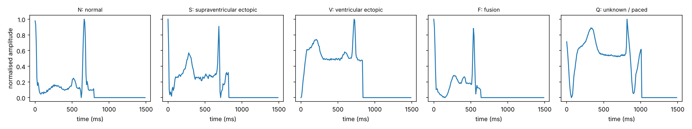
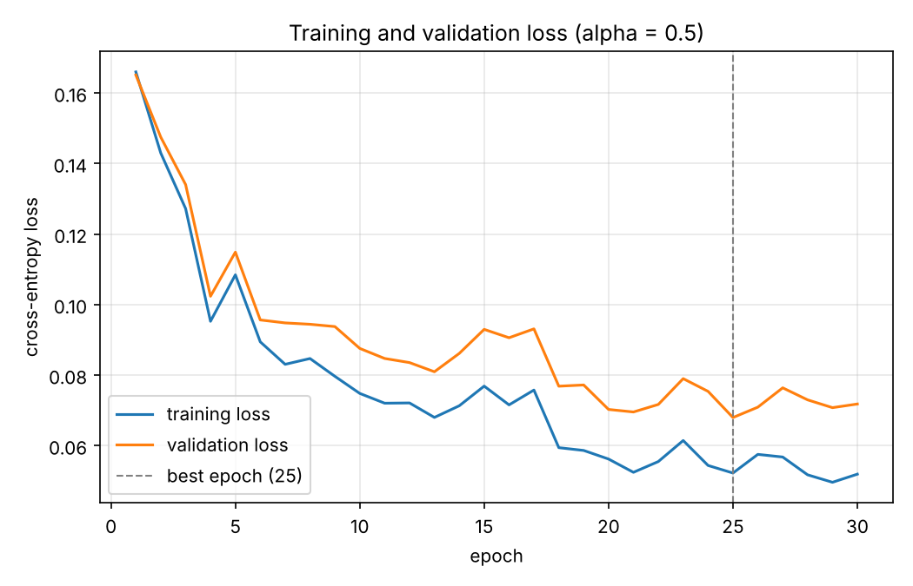
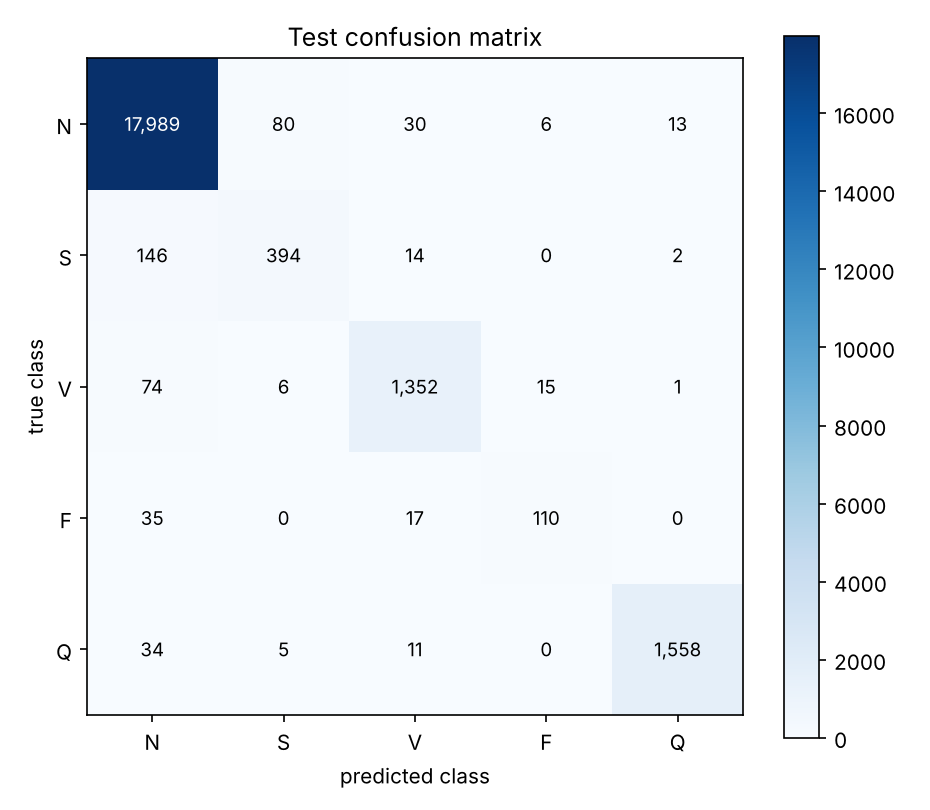

# Teaching a Small Neural Network to Read Heartbeats: ECG Classification from Scratch in PyTorch

*Is 97.8 % accuracy a good result when four out of five heartbeats are normal?*

## The problem

An electrocardiogram (ECG) records the electrical activity of the heart. Every heartbeat produces a characteristic waveform, and abnormal beats (arrhythmias) have different shapes. A bedside monitor has to recognise them quickly. In this project I built a neural network **from scratch in PyTorch** that looks at a single heartbeat, 187 samples of the signal at 125 samples per second, and decides which of five types it is:

- **N** – normal beat
- **S** – supraventricular ectopic beat
- **V** – ventricular ectopic beat
- **F** – fusion beat
- **Q** – unknown or paced beat

The practical question behind the project: *how well does a small network recognise each type of beat, and is overall accuracy the number to trust when one class is far more common than the others?*

## The data

I used the MIT-BIH part of the ECG Heartbeat Categorization Dataset from Kaggle: 87,554 training beats and 21,892 test beats. I carved a validation set (10 %) out of the training file with a fixed random seed, which gave **78,799 train / 8,755 validation / 21,892 test** rows. The signals are already scaled to the range 0–1, so I used them as they are.

The classes are very unbalanced: 72,471 of the 87,554 training beats (83 %) are normal, while the fusion class F has only 641 rows (0.7 %).

| Class | N | S | V | F | Q |
|---|---:|---:|---:|---:|---:|
| Train file | 72,471 | 2,223 | 5,788 | 641 | 6,431 |
| Test file | 18,118 | 556 | 1,448 | 162 | 1,608 |

Here is one example beat per class:

The normal beat has a flat baseline and one sharp, narrow peak. The S beat looks similar but has a larger bump before the peak and an extra bump after it. The V beat is much wider: a broad hump rises from the start of the window and the sharp peak sits on top of a raised plateau. The F beat is a shorter beat whose peak comes earlier, and the Q beat is the longest one with a large broad hump and deep dips around the peak.

## The network

The network is a plain fully connected network: 187 inputs, a hidden layer of 128 ReLU units, a hidden layer of 64 ReLU units and 5 output logits. That is 24,064 + 8,256 + 325 = **32,645 trainable parameters**. I created every weight matrix and bias myself as an `nn.Parameter`, initialised the weights with the **He rule** (normal distribution with standard deviation sqrt(2 / n_in)), wrote ReLU with `torch.clamp`, and wrote the forward pass as `Z = A·Wᵀ + b`. No `nn.Linear`, no `torch.optim`, no ready-made loss.

The loss is the **softmax cross-entropy**, written with `torch.logsumexp` for numerical stability: L = −z_y + log Σ exp(z_j). Before training I checked my understanding of backpropagation: for the output layer the gradient is (1/B)(Ŷ − Y)ᵀA², and I computed it by hand on 64 training rows and compared it with PyTorch's automatic gradient. The two agreed to floating-point precision (maximum difference 0, well below the required 10⁻⁵). A fresh network had a loss of 1.72, close to log 5 = 1.61, as expected for five roughly equally likely classes.

## Training

I wrote the update rule myself: mini-batches of 128, 30 epochs, shuffling every epoch, momentum β = 0.9 (v = βv + (1−β)g, P = P − αv) and L2 weight decay λ = 10⁻⁴ on the weights only. The learning rate was chosen from {0.01, 0.1, 0.5} by the lowest validation loss:

| α | Lowest validation loss | Validation accuracy |
|---|---:|---:|
| 0.01 | 0.1624 | 95.74 % |
| 0.1 | 0.0820 | 97.62 % |
| 0.5 | **0.0680** | **98.12 %** |

So **α = 0.5** won, and I kept the weights of the epoch with the lowest validation loss (epoch 25: training loss 0.0523, validation loss 0.0680, validation accuracy 98.12 %). The whole training for one learning rate took about 17 seconds on a CPU.

## Results on the test set

The test rows were used exactly once, after all choices were made.

| | N | S | V | F | Q |
|---|---:|---:|---:|---:|---:|
| Per-class accuracy | 99.29 % | 70.86 % | 93.37 % | 67.90 % | 96.89 % |

| Metric | Value |
|---|---:|
| Test accuracy | **97.77 %** |
| Balanced accuracy | **85.66 %** |
| "Always N" accuracy | 82.76 % |

## What the numbers tell us

**Is accuracy enough?** No. A model that always answers "N" already scores 18,118 / 21,892 = 82.76 % without looking at any signal. Our 97.77 % looks excellent, but the balanced accuracy (the average of the five per-class accuracies) is only 85.66 %. N is recognised 99.29 % of the time, but S and F, the rare classes, are recognised only about 70 % of the time. For a heart monitor, missing the rare beat is the failure that matters.

**Which class is hardest?** The fusion class F (67.90 %). In the confusion matrix 35 of 162 F beats are predicted as N and 17 as V. This makes sense: a fusion beat is produced when a normal and a ventricular beat happen at almost the same time, so its shape is a mixture of N and V, and the network has only 641 training examples of it. S is close behind (70.86 %); 146 of its 556 beats are predicted as N because they look much like normal beats.

**Overfitting?** At the best epoch the training loss (0.052) and validation loss (0.068) are close, and both fall during training. The validation loss is noisy because of the large learning rate, but it never clearly turns upward, so the network is neither strongly overfitting nor underfitting. The smallest learning rate, 0.01, was still improving at epoch 30: it is simply too slow.

**Why not zero weights, and why the He rule?** If all weights start at zero, all units of a layer compute the same thing and get the same gradient, so they never become different (and with ReLU the hidden activations are zero, so almost nothing is learned at the start). The factor 2 in sqrt(2 / n) compensates for the fact that ReLU sets about half of the activations to zero: it keeps the variance of the signal the same from layer to layer.

**Momentum and weight decay.** If two consecutive gradients point in opposite directions, momentum partly cancels them in the velocity, so the step becomes smaller and the oscillation is damped. A weight that receives no gradient is pulled towards zero by weight decay, shrinking by about a factor (1 − αλ) per step.

**How to help the rare class F?** One idea (not run here) is a class-weighted cross-entropy: give each example a weight proportional to 1 / (number of rows of its class), so one mistake on a rare F beat costs as much as many mistakes on normal beats. Oversampling F beats or adding slightly noisy or shifted copies would work in a similar way on the data side.

## Code

All code (data preparation, network, gradient check, training and evaluation) and all results are in the GitHub repository: **[add your repository link here]**.

## Conclusion

A tiny network with only 32,645 parameters, written from scratch, reaches 97.8 % test accuracy on heartbeat classification, but the balanced accuracy of 85.7 % shows that the rare beat types are still recognised much worse than the normal one. On imbalanced data, always look at the per-class results and the confusion matrix, not only at the overall accuracy.
